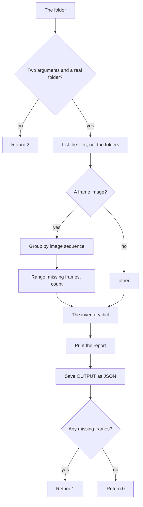
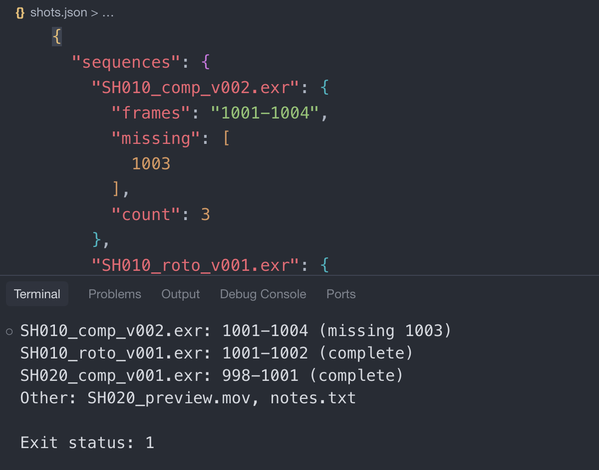

# Capstone — Shot Inventory

You'll combine your Chapter 1 functions into the tool that [Lesson 1.1](chapters/01-shot-inventory/01-names-carry-data.md) describes. One string method is new, `join()`, and it is explained where you need it; `isdigit()` comes from [Lesson 1.8](chapters/01-shot-inventory/08-grouping.md). Give the tool a messy folder, and it puts the files into groups by image sequence, finds the holes (missing frames), lists what doesn't belong, prints a report, and saves the inventory as JSON. It reads the folder and never changes it.



## The brief

Open `src/chapter_01/lesson_12.py` and write three functions. You can import your own earlier work, such as `from chapter_01.lesson_07 import format_run`, or copy what you need.

**1. `inventory(folder)`** returns a dict for the files (not folders) directly inside `folder`:

```text
inventory("docs/chapters/01-shot-inventory/sample/dump")
→ {
    "sequences": {
      "SH010_comp_v002.exr": {"frames": "1001-1004", "missing": [1003], "count": 3},
      "SH010_roto_v001.exr": {"frames": "1001-1002", "missing": [], "count": 2},
      "SH020_comp_v001.exr": {"frames": "998-1001", "missing": [], "count": 4},
    },
    "other": ["SH020_preview.mov", "notes.txt"],
  }
```

- A **frame image** is a `.exr` or `.dpx` file, in any letter case, named `SEQUENCE.FRAME.ext`, as in [Lesson 1.3](chapters/01-shot-inventory/03-splitting.md), where `FRAME` is digits only (`isdigit()`, as in [Lesson 1.8](chapters/01-shot-inventory/08-grouping.md)).
- Each image sequence is keyed by the frame image's name without the dot and frame number: the sequence part plus the extension as written, which already starts with its dot. `SH010_comp_v002.1001.exr` belongs to `SH010_comp_v002.exr`. So `.exr` and `.dpx` frames of one name are two image sequences, and so are `.exr` and `.EXR`.
- `"frames"` is the range from the image sequence's first frame to its last, written as in [Lesson 1.7](chapters/01-shot-inventory/07-sorting.md).
- `"missing"` lists the frames missing *between* the first and the last, sorted.
- `"count"` is the number of distinct frames in the image sequence.
- Every other file goes in `"other"`, sorted: names `split_frame_name` rejects, and names whose frame part isn't digits. Subfolders are skipped.

**2. `report_lines(result)`** turns that dict into lines for a person, image sequences in sorted order, then the other files:

```text
SH010_comp_v002.exr: 1001-1004 (missing 1003)
SH010_roto_v001.exr: 1001-1002 (complete)
SH020_comp_v001.exr: 998-1001 (complete)
Other: SH020_preview.mov, notes.txt
```

- Several missing frames are joined by `", "`, such as `(missing 1003, 1007)`.
- The other files are joined by `", "` too.
- The last line is `Other: none` when there are no other files.

`", ".join(texts)` puts `", "` between the strings of a list: `", ".join(["1003", "1007"])` gives `"1003, 1007"`. It takes only text, so turn each frame into text with `str()` first.

**3. `main(args)`** for the command `shot-inventory FOLDER OUTPUT`:

| Situation | Prints | Returns |
|---|---|---|
| Not exactly two arguments | `usage: shot-inventory FOLDER OUTPUT` | `2` |
| `FOLDER` isn't an existing folder | `error: <folder> is not a folder` | `2` |
| No image sequence has missing frames | the report lines, and saves the inventory to `OUTPUT` as JSON ([Lesson 1.10](chapters/01-shot-inventory/10-json.md)) | `0` |
| Some image sequence has missing frames | the same | `1` |

- The `usage:` line is printed exactly as shown. In the `error:` line, `<folder>` stands for the folder argument as the user typed it.
- Missing frames in any image sequence make the result `1`. Other files don't: complete image sequences plus `notes.txt` still give `0`.
- Add the guard, as in [Lesson 1.11](chapters/01-shot-inventory/11-script.md).

> Expected: `main(["gone", "shots.json"])` prints `error: gone is not a folder` → `2`

Save `OUTPUT` outside `FOLDER`. The tool doesn't skip its own file, so on the next run it would list its own `shots.json` as an other file.

`1` means the tool ran fine and found a problem, so another program can tell "frames are missing" from "the command was used wrong". Python also exits with `1` when an error is not caught. Then it also prints a traceback, Python's error report. The traceback shows which of the two happened.

Check your work:

```console
academy test 1 12
```

When the checks pass, run it yourself:

```console
uv run python -m chapter_01.lesson_12 docs/chapters/01-shot-inventory/sample/dump shots.json
```

```text
SH010_comp_v002.exr: 1001-1004 (missing 1003)
SH010_roto_v001.exr: 1001-1002 (complete)
SH020_comp_v001.exr: 998-1001 (complete)
Other: SH020_preview.mov, notes.txt
```



The screenshot shows a completed implementation. The terminal report is for a person; `shots.json` stores the same facts for another program. Frame `1003` appears in both as missing. The exit code is `1` because the tool found missing frames, not because it failed to run.

## Plan before you code

!!! question "Think"

    Which lesson answers each step: listing the files, telling frames from other files, grouping by image sequence, finding the holes, writing the range, saving the result, and running from the terminal?

??? success "Answer"

    - Listing the folder: `list_files` ([Lesson 1.9](chapters/01-shot-inventory/09-folders.md)).
    - Frames versus other files, and splitting names into parts: `split_frame_name` ([Lesson 1.3](chapters/01-shot-inventory/03-splitting.md)).
    - Grouping by image sequence: `group_by_sequence` ([Lesson 1.8](chapters/01-shot-inventory/08-grouping.md)) gives each image sequence's frames, each frame once and sorted. It skips every other name, so you still collect the names for `"other"` yourself, with the same two conditions: `split_frame_name` returns `None`, or the frame part isn't digits.
    - The frames between first and last, and the missing ones: `frame_list` and `missing_frames` ([Lessons 1.5](chapters/01-shot-inventory/05-ranges.md) and [1.6](chapters/01-shot-inventory/06-sets.md)).
    - The range, such as `1001-1004`: `format_run` ([Lesson 1.7](chapters/01-shot-inventory/07-sorting.md)).
    - Saving the inventory: `save_json` ([Lesson 1.10](chapters/01-shot-inventory/10-json.md)).
    - `main`, exit codes, and the guard: [Lesson 1.11](chapters/01-shot-inventory/11-script.md).

Run it on the sample, then make a copy of the sample folder, change it, and predict the report before you run the tool again.

## What next

Open the `shots.json` you saved: any program can now read your inventory. Module 5 of the full course shows how to let an AI model answer questions about data like this, such as "which shot is incomplete?", using only the facts your code produced.

## Further reading

- [`str.join`](https://docs.python.org/3/library/stdtypes.html#str.join) (Python reference): the one new method, and the `TypeError` it raises when an item isn't text.
- [Exit status](https://en.wikipedia.org/wiki/Exit_status#Shell_and_scripts) (Wikipedia): zero for success and nonzero for a problem, the convention behind your `0`, `1`, and `2`.
- [VFX Image Sequence Naming](https://movielabs.com/prodtech/sdw/vfx/ETC-ImageSequenceNaming-v1.0-063020-FINAL.pdf) (ETC at USC, 2020, PDF): an industry proposal for naming image sequences, the kind of names this tool reads.
