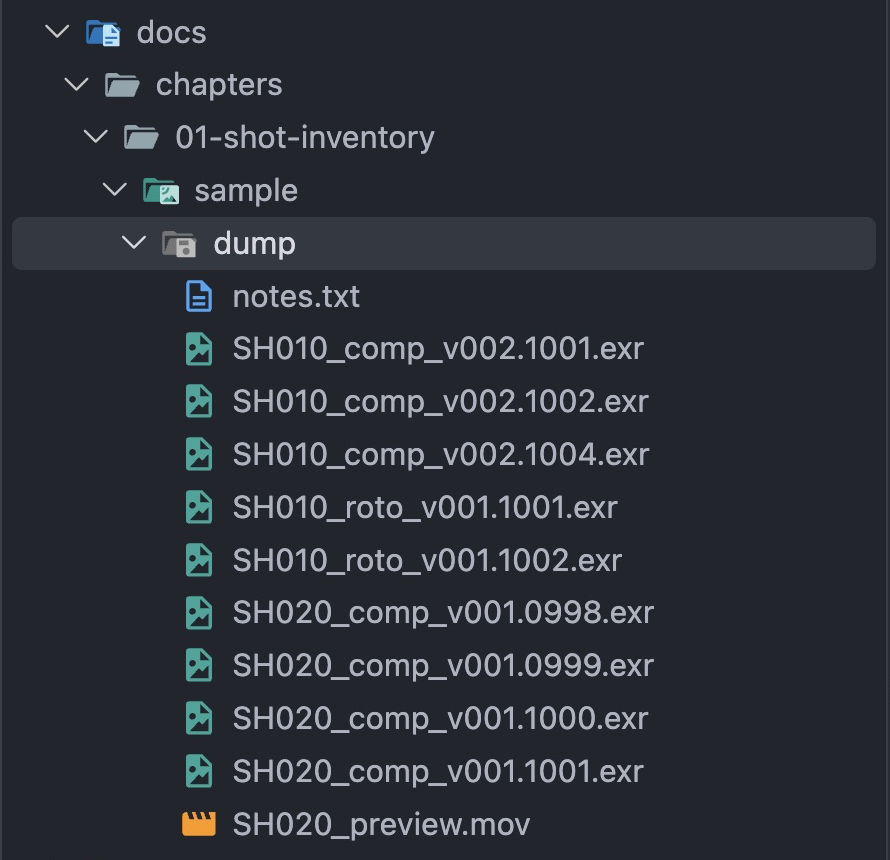

# Lesson 1.1 — Names Carry Data

Imagine a film production in a hurry. Artists on several shots have been saving their image files into one shared folder. Someone has to answer simple questions, and nobody can: which shots are in here? Is anything missing? Which version is the newest? The files aren't the problem. The problem is that nobody has read what their **names** already say.

## A filename is a record

A **shot** is one continuous piece of a film, such as `SH010`. Each shot is a series of still images, **frames**, numbered in order. The number labels the picture; it doesn't count from 1. Studios often start at 1001, so frames can be added before the first one: `SH020` starts at `0998`.

Different people work on the same shot: a compositor (`comp`, short for compositing) builds the final picture, and a roto artist (`roto`) traces outlines to separate a person or object from the background. The kind of work is the **task**: `comp` or `roto`. Each time they deliver (hand in their work), the **version** goes up: `v001`, `v002`. A studio names every frame file by one rule:

```text
SH010_comp_v002.1001.exr
│     │    │    │    └── extension: the file type
│     │    │    └─────── frame number, padded to four digits
│     │    └──────────── version
│     └───────────────── task
└─────────────────────── shot
```

The part before the dot and frame number, `SH010_comp_v002`, is the image sequence's name. An **image sequence** is all the frames of one shot, task, and version in one file type. The frame number picks one picture, and the extension gives the type, so `.exr` and `.dpx` frames with the same name are two image sequences, and so are `.exr` and `.EXR`: the extension counts as written. So the name alone says which shot, which task, which delivery, and which picture in the series.

The text of this course says "image sequence"; code names such as `sequence_name` shorten it to "sequence". In a studio, "sequence" alone usually means a group of shots.

## The folder

The sample folder, `docs/chapters/01-shot-inventory/sample/dump/` in your project, contains:

```text
SH010_comp_v002.1001.exr    SH020_comp_v001.0998.exr
SH010_comp_v002.1002.exr    SH020_comp_v001.0999.exr
SH010_comp_v002.1004.exr    SH020_comp_v001.1000.exr
SH010_roto_v001.1001.exr    SH020_comp_v001.1001.exr
SH010_roto_v001.1002.exr    SH020_preview.mov
notes.txt
```



Open the same folder in VS Code's Explorer to inspect the names yourself. The sample `.exr` files are tiny text files that take the place of images; they aren't real images.

!!! question "Think"

    Suppose the folder also held `SH010_comp_v001.1001.exr`. A tool groups frames by shot and task only, and leaves out the version. What does it find for frame 1001 of `SH010_comp`?

??? success "Answer"

    Two images for one frame: one from `v001` and one from `v002`. The tool can't tell which one to use, so it mixes two deliveries into one series. That is why the version is part of the image sequence's name. Only the frame number changes from one frame to the next; the shot, task, version, and extension stay the same for every frame of an image sequence.

!!! question "Think"

    Look at the sample folder. Which image sequences does it hold, which frames are missing inside an image sequence, and which files are not frames?

??? success "Answer"

    Three image sequences: `SH010_comp_v002` (frames 1001, 1002, 1004), `SH010_roto_v001` (1001, 1002), and `SH020_comp_v001` (`0998` to `1001`). Frame 1003 of `SH010_comp_v002` is missing: the numbers jump from 1002 to 1004. `SH020_preview.mov` and `notes.txt` aren't frames; keep them, but report them separately. `notes.txt` is worth reading: it explains the hole, the missing frame.

!!! question "Think"

    Why is frame 1003 of `SH010_comp_v002` reported missing, but frame 1000 is not?

??? success "Answer"

    The folder only shows where each image sequence starts and ends. A gap between the first and last frame is clearly a hole. Nothing in the folder says the shot should start earlier, so frame 1000 isn't missing; it may never have existed. In a studio, each shot's frame range is set in advance, and a checker compares the folder against it. This chapter has only the folder.

You just read the folder yourself. The rest of this chapter teaches Python to do the same, for any folder, in less than a second.

## Further reading

- [VFX Image Sequence Naming](https://movielabs.com/prodtech/sdw/vfx/ETC-ImageSequenceNaming-v1.0-063020-FINAL.pdf) (ETC at USC, 2020, PDF): an industry proposal for naming image sequences. Section 2.11 covers padded frame numbers and the 1001 start. A footnote in Section 2.3 explains that a VFX sequence (a group of shots) is not an image sequence.
- [Shot](https://en.wikipedia.org/wiki/Shot_(filmmaking)) (Wikipedia): what a shot is in filmmaking, a run of frames without a cut.
