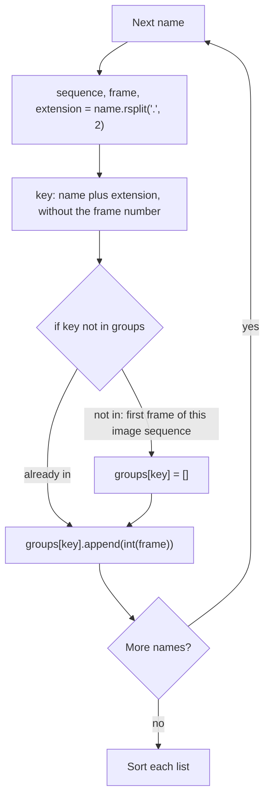

# Lesson 1.8 — Dictionaries: Grouping by Sequence

The folder is one long list of names from several image sequences. To check each image sequence on its own, you first put the names into groups: all the `SH010_comp_v002` `.exr` frames together, all the `SH020_comp_v001` `.exr` frames together. A **dictionary** maps each image sequence's **key**, its name plus its extension such as `SH010_comp_v002.exr`, to a list of its frames. [Lesson 1.3](03-splitting.md) wrote one out by hand; here a loop builds it.

## Building groups

Each key is the file name without its frame number: `SH010_comp_v002.1001.exr` goes under the key `SH010_comp_v002.exr`. The extension stays in the key, because each extension is its own image sequence: a `.dpx` copy of the same frames is a second image sequence. If the `.dpx` copy lacks frame 1003, that copy has a hole, even when the `.exr` has the frame.

```python
names = ["SH010_comp_v002.1002.exr", "SH020_comp_v001.0998.exr", "SH010_comp_v002.1001.exr"]
groups = {}
for name in names:
    sequence, frame, extension = name.rsplit(".", 2)
    key = f"{sequence}.{extension}"
    if key not in groups:  # first frame of this image sequence: start its list
        groups[key] = []
    groups[key].append(int(frame))
print(groups)
for key in groups:
    groups[key].sort()
print(groups)
```

```text
{'SH010_comp_v002.exr': [1002, 1001], 'SH020_comp_v001.exr': [998]}
{'SH010_comp_v002.exr': [1001, 1002], 'SH020_comp_v001.exr': [998]}
```

The f-string from [Lesson 1.2](02-f-strings.md) puts the name back together without its frame number. The first time a key appears, it isn't in `groups` yet, so the loop gives it an empty list. `in` on a dictionary checks keys, not values. Then `.append` adds the frame to that key's list. After the loop, every image sequence has its frames, in the order the names came.



To sort each list, loop over the dictionary: a `for` loop over a dictionary gives you its keys. `.sort()` changes each list in place, as in [Lesson 1.7](07-sorting.md), so you don't assign its result.

!!! question "Think"

    What happens if you delete the two `if` lines? On which name does it fail, and why?

??? success "Answer"

    It fails with `KeyError` on the very first name. `groups[key]` reads a key that doesn't exist yet, because `groups` is still empty. The `if` creates each image sequence's list once. Then the `append` runs for every frame, the first one included.

!!! question "Think"

    The loop unpacks three values from `rsplit(".", 2)`. What happens if `names` holds `notes.txt`?

??? success "Answer"

    The loop stops with `ValueError: not enough values to unpack (expected 3, got 2)`. `"notes.txt".rsplit(".", 2)` gives only two pieces, and three names need three values. Unpacking checks only the number of pieces, not what they hold: `SH020_preview.0001.mov` unpacks fine and would get its own key. Unpacking also names each piece, and the loop uses all three: `sequence` and `extension` build the key, and `frame` goes in the list. A real folder holds files like `notes.txt`, so the assignment skips them instead of stopping: your [Lesson 1.3](03-splitting.md) `split_frame_name` returns `None` for them.

## Frames that aren't numbers

A folder can also hold `SH010_comp_v002.abcd.exr`, or a frame with a sign, such as `SH010_comp_v002.-001.exr`. `int("abcd")` raises a `ValueError` and stops the loop. `int("-001")` from [Lesson 1.4](04-numbers.md) works and gives `-1`, so the group gets a frame that no file of the image sequence has. Test the text before you convert it: `isdigit()` returns `True` when the text has at least one character and every character is a digit.

```python
print("1001".isdigit(), "abcd".isdigit(), "-001".isdigit(), "".isdigit())
```

```text
True False False False
```

A minus sign isn't a digit, and neither is a space, so `"-001"` and `" 12"` fail the test, while `int()` accepts both. Python also counts digits from other writing systems as digits. Module 0's files use only `0` to `9`, so you need to do nothing about them here; Module 1 deals with them.

!!! question "Think"

    Without `isdigit()`, the folder holds `a.0001.exr`, `a.-001.exr`, and `a.0002.exr`. What would `format_run` from [Lesson 1.7](07-sorting.md) report, and what would `missing_frames` from [Lesson 1.6](06-sets.md) report when it expects every frame from the first to the last?

??? success "Answer"

    The frames become `[-1, 1, 2]`. `format_run(-1, 2)` gives `"-1-2"`, a range nobody can read. `missing_frames` expects every frame from `-1` to `2`, so it reports frame `0` as missing: a hole that doesn't exist, caused by a file that isn't a frame.

## Assignment

Open `src/chapter_01/lesson_08.py`.

**`group_by_sequence(names)`** returns a dict from each image sequence's key, the file name without its frame number, to its frame numbers, sorted from smallest to largest.

Start from your [Lesson 1.3](03-splitting.md) function: `from chapter_01.lesson_03 import split_frame_name`. It returns `None` for a name to skip; otherwise, read `parts["sequence"]`, `parts["frame"]`, and `parts["extension"]`, which already starts with its dot. The rules:

- Only frame images count: names that `split_frame_name` accepts. Skip every other name, such as `notes.txt` and `SH020_preview.0001.mov`.
- Skip a name whose frame part isn't digits, such as `SH010_comp_v002.abcd.exr`.
- Each extension is its own image sequence: `a.0007.exr` and `a.0007.dpx` give `{"a.exr": [7], "a.dpx": [7]}`. Keep the extension as written, so `A.0001.EXR` goes under `"A.EXR"`.
- List each frame of an image sequence once, even when two names give the same frame, such as `a.0007.exr` and `a.7.exr`; a set from [Lesson 1.6](06-sets.md) removes repeats.

> Expected: `group_by_sequence(["SH010_comp_v002.1002.exr", "notes.txt", "SH010_comp_v002.1001.exr"])` → `{"SH010_comp_v002.exr": [1001, 1002]}`

Check your work:

```console
academy test 1 8
```

## Further reading

- [Dictionaries](https://docs.python.org/3/tutorial/datastructures.html#dictionaries) (Python tutorial): keys, `in`, the `KeyError` for a missing key, and looping over a dictionary.
- [`str.isdigit`](https://docs.python.org/3/library/stdtypes.html#str.isdigit) (Python reference): exactly which characters count as digits, including the ones from other writing systems.
- [Learn Python in Y Minutes](https://learnxinyminutes.com/python/) (Learn X in Y Minutes): dictionaries and unpacking on one page, as short commented examples.
